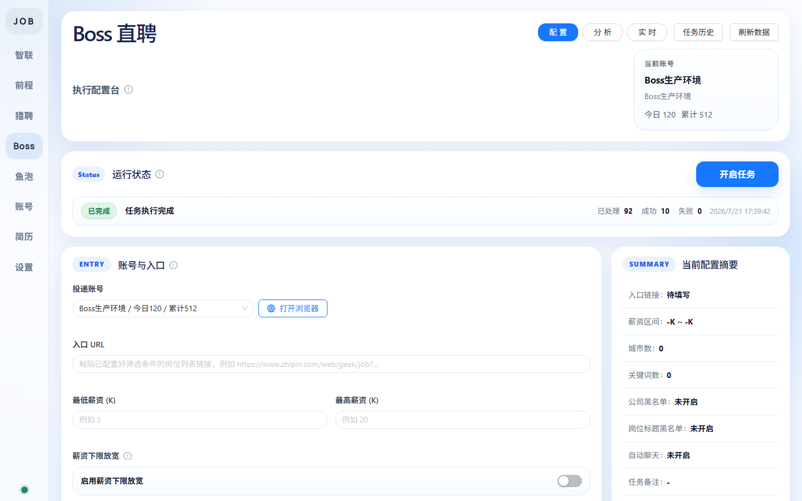
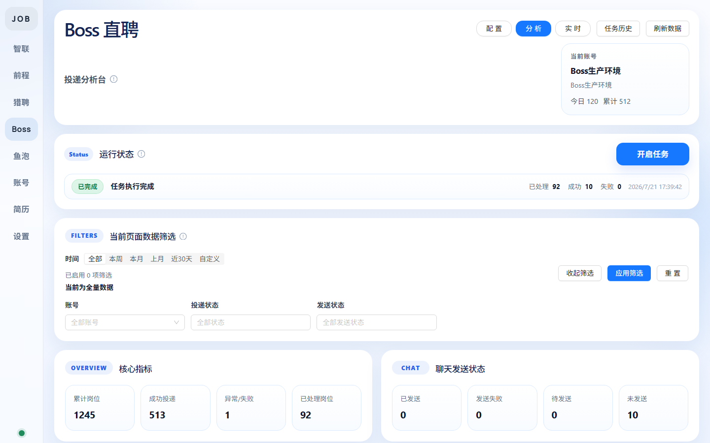
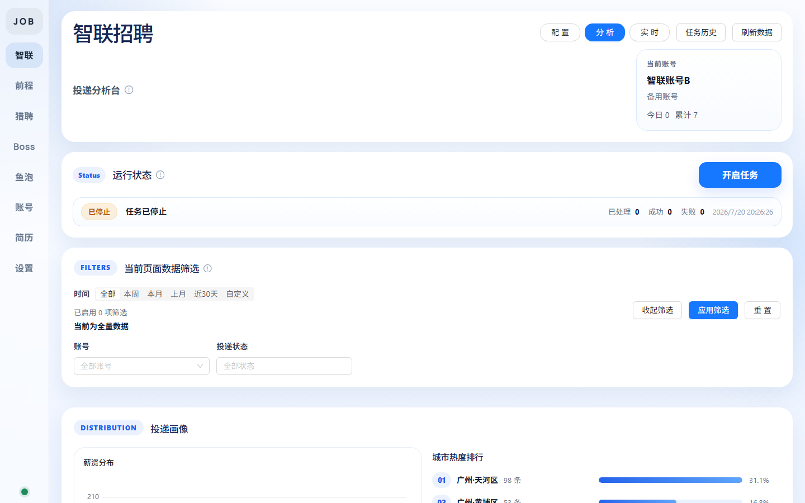
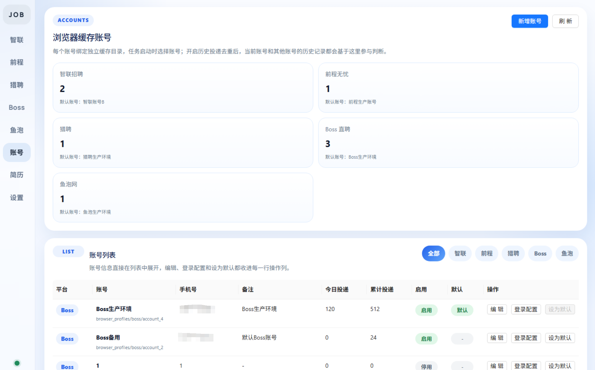

<div align="center">

# JobHelp

### 多平台求职投递自动化工具

支持 Boss 直聘、猎聘、前程无忧、智联招聘、鱼泡网五大平台的自动投递、聊天沟通与数据分析

[](https://python.org) [](https://fastapi.tiangolo.com) [](https://vuejs.org) [](https://playwright.dev) [](LICENSE)

</div>

---

## 功能概览

**多平台自动投递**

- 支持 Boss 直聘、猎聘、前程无忧、智联招聘、鱼泡网
- 基于真实浏览器的 Playwright 自动化，保留登录态
- 按关键词、城市、薪资区间自动筛选岗位
- 自定义投递间隔、单次投递上限，避免触发风控

**智能过滤系统**

- 公司黑名单（模糊匹配）
- 岗位标题黑名单（模糊匹配，拦截不想投的方向）
- 薪资区间匹配，支持"下限容差"模式（如最低薪资 <10K 但最高 >=15K 仍可投递）
- 跨账号投递去重（按岗位标题 / 公司名匹配）
- 冷却期去重（N 天内投过的岗位自动跳过）
- Boss 招聘官在线状态过滤（仅投递在线 / 刚活跃的招聘官）

**Boss 自动聊天**

- 不再提供“自动聊天总开关”，由模板 / 常用语 / 图片 / 同意微信 / 自动跟进等子功能独立控制
- 任一聊天子功能开启后，投递成功就会进入聊天动作
- 首聊模板支持变量（`{job_title}` / `{company_name}`）
- 常用语快捷发送（Boss 内置常用语短语）
- 图片简历自动发送
- 招聘官消息自动跟进回复（基于关键词规则匹配）
- 自动同意交换微信名片
- 聊天发送状态实时追踪（PENDING / SENT / FAILED）

**任务历史与回溯**

- 每次任务完整记录运行配置（搜索词、关键词、城市、薪资、黑名单等）
- 任务历史弹窗 + 分页浏览
- 单条历史详情查看，支持一键恢复当时配置
- 自动记录打开链接的标题（解码后显示，不显示原始 URL）

**数据分析台**

- 薪资分布、经验分布、城市分布、关键词云图
- 投递成功率统计与趋势对比
- 按日期范围筛选分析数据
- AI 投递策略建议（接入 LLM，分析投递数据并给出薪资区间、投递时间建议）
- 可配置分析字段（选择需要纳入分析的维度）

**多账号管理**

- 每个平台支持多个账号，独立浏览器缓存目录
- 账号级投递计数（今日 / 累计）
- 一键打开浏览器（携带账号 Cookie，直达平台网站）
- 账号启用 / 停用控制

**简历同步**

- 跨平台简历导入与同步
- 主简历管理（一处编辑，多平台同步）
- 支持字段级同步选择

**实时预览**

- Headless / 有头模式切换
- 投递过程实时截图预览
- 运行状态面板实时展示当前步骤

## 截图

| 投递配置 | 数据分析 |
|:---:|:---:|
|  |  |

| 分析台（智联） | 账号管理 |
|:---:|:---:|
|  |  |

## 技术栈

| 层 | 技术 |
|---|---|
| 后端 | Python 3.12+ / FastAPI / SQLAlchemy / Pydantic |
| 前端 | Vue 3.5 / TypeScript / Ant Design Vue / ECharts |
| 自动化 | Playwright（真实浏览器驱动） |
| 桌面端 | PyInstaller / pywebview / Inno Setup |
| 数据库 | SQLite（零配置，本地存储） |

## 快速开始

### 环境要求

- Python 3.12+
- Node.js 18+
- Playwright 浏览器（首次运行需安装）

### 后端

```bash
# 安装依赖
pip install -r requirements.txt

# 安装 Playwright 浏览器
python -m playwright install chromium

# 启动后端（默认端口 8000）
uvicorn app.main:app --reload
```

### 前端

```bash
cd fronted

# 安装依赖
npm install

# 启动开发服务器（默认端口 5173）
npm run dev
```

打开浏览器访问 `http://127.0.0.1:5173` 即可使用。

> 前端开发模式下 API 请求会自动代理到 `http://127.0.0.1:8000/api`

## 使用流程

1. **添加账号** — 在「账号」页面为每个平台添加账号，首次使用需点击「登录配置」完成平台登录
2. **配置任务** — 进入对应平台页面，配置搜索词、城市、薪资区间、过滤规则等
3. **启动投递** — 点击「开始投递」，系统将自动打开平台并按配置筛选岗位进行投递
4. **查看数据** — 投递完成后在「分析台」查看投递统计、薪资分布、城市分布等
5. **AI 建议** — 选择日期范围，让 LLM 分析投递数据并给出策略建议

## 项目结构

```
job_help_api/
├── app/                        # 后端
│   ├── api/routes.py           # FastAPI 路由
│   ├── automation/
│   │   ├── adapters/           # 各平台适配器（Boss/Liepin/Qiancheng/Zhilian/Yupao）
│   │   ├── browser_factory.py  # 浏览器实例工厂
│   │   └── browser_profiles.py # 浏览器配置目录管理
│   ├── core/config.py          # 全局配置
│   ├── db/                     # 数据库与迁移
│   ├── models/entities.py      # ORM 模型
│   ├── schemas/common.py       # Pydantic 请求/响应模型
│   └── services/
│       ├── task_runner.py      # 任务运行器（核心投递逻辑）
│       ├── ai_advisor_service.py # LLM 投递建议
│       ├── analysis_service.py # 数据分析
│       ├── account_service.py  # 账号管理
│       ├── resume_sync_service.py # 简历同步
│       └── live_preview_service.py # 实时预览
├── fronted/                    # 前端（注意拼写）
│   └── src/
│       ├── components/         # Vue 组件
│       ├── pages/             # 页面
│       ├── composables/       # 状态管理
│       └── api.ts             # API 客户端
├── docs/                       # 文档与截图
├── requirements.txt            # 后端依赖
├── requirements-desktop.txt   # 桌面端打包依赖
├── build_desktop_bundle.ps1    # Windows 桌面端构建脚本
└── JobHelpDesktop.spec         # PyInstaller 打包配置
```

## 桌面端打包

Windows 桌面端（目录版 + 安装包）统一通过以下脚本构建：

```powershell
.\build_desktop_bundle.ps1
```

构建流程：

1. 构建前端 `dist`
2. 复制到后端 `frontend_dist`
3. 生成空数据库模板
4. 使用 PyInstaller 生成 `dist_desktop\JobHelpDesktop`
5. 如果已安装 Inno Setup 6，继续生成安装包到 `dist_installer`

可选参数：

```powershell
.\build_desktop_bundle.ps1 -SkipInstaller
.\build_desktop_bundle.ps1 -SkipPyInstaller
.\build_desktop_bundle.ps1 -InnoSetupCompiler "C:\Program Files (x86)\Inno Setup 6\ISCC.exe"
```

## LLM 配置

在「设置」页面配置 LLM 模型信息后，即可在分析台使用 AI 投递建议功能：

- 支持自定义 API Base URL、API Key、模型名称
- 兼容 OpenAI API 格式（支持对接各种大模型服务）
- 分析时可选择具体日期范围
- AI 会根据投递数据分析薪资区间合理性、投递时间分布、岗位匹配度，并给出下次投递的建议

## 支持平台

| 平台 | 自动投递 | 自动聊天 | 简历同步 |
|:---:|:---:|:---:|:---:|
| Boss 直聘 | ✓ | ✓ | ✓ |
| 猎聘 | ✓ | ✓ | ✓ |
| 前程无忧 | ✓ | — | ✓ |
| 智联招聘 | ✓ | — | ✓ |
| 鱼泡网 | ✓ | ✓ | ✓ |

## 贡献

欢迎提交 Issue 和 Pull Request。

1. Fork 本仓库
2. 创建特性分支 (`git checkout -b feature/amazing-feature`)
3. 提交更改 (`git commit -m 'Add amazing feature'`)
4. 推送到分支 (`git push origin feature/amazing-feature`)
5. 发起 Pull Request

## 免责声明

本项目仅供学习与个人求职辅助使用。使用者需自行承担因使用本工具产生的一切风险和责任。请遵守各平台的使用条款与服务协议，合理设置投递频率。开发者不对因不当使用造成的任何后果承担责任。

## 许可证

本项目采用 [PolyForm Noncommercial License 1.0.0](LICENSE)。

- 允许个人学习、研究、实验与非商业使用
- **禁止商业售卖、收费分发、付费服务、商业 SaaS 或其他营利用途**
- 分发时需保留许可证原文或官方链接，以及 `Required Notice`

详细条款以 [LICENSE](LICENSE) 英文正文为准。

## GitHub 自动打包 Release

推送版本标签后，GitHub Actions 会自动构建 Windows 安装包与便携版压缩包，并上传到对应 Release：

```bash
git tag v0.1.0
git push origin v0.1.0
```

也可在 GitHub Actions 页面手动触发 `Release Windows` 工作流。

产物包括：

- `JobHelpDesktop-Setup.exe`（Inno Setup 安装包）
- `JobHelpDesktop-windows-x64-vX.Y.Z.zip`（目录便携版）
