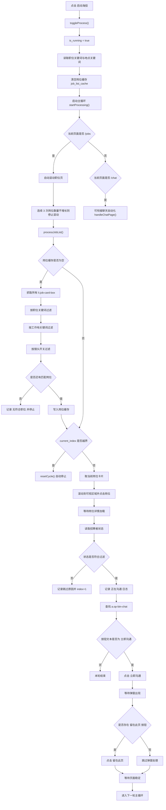

# BOSS「启动海投」流程说明（面向 Python + Playwright 实现）

## 1. 文档目的

本文档基于 `G:\CodeProject\Script\Boss\Boss_helper.js` 中“启动海投”相关逻辑整理，目标是帮助将该流程融合到 Python 自动化脚本中，并通过 Playwright 实现页面操作。

本文重点描述：

- 按钮点击后的完整业务流程
- 主循环与状态设计
- 页面元素和关键选择器
- 岗位筛选与沟通触发逻辑
- 停止条件与边界行为
- 适合 Playwright 的实现建议

---

## 2. 总体结论

“启动海投”本质上是一个持续运行的自动投递/自动沟通循环，不是只点击一次“立即沟通”按钮。

点击后，脚本会：

1. 读取职位关键词和工作地关键词
2. 清空当前岗位缓存
3. 进入运行状态
4. 启动主循环 `startProcessing()`
5. 若当前在职位列表页 `/jobs`：
   - 先自动滚动页面，把岗位尽量加载全
   - 再从所有岗位中筛选符合条件的卡片
   - 逐个点击岗位
   - 检查招聘者状态
   - 对满足条件的岗位点击“立即沟通”
   - 处理“留在此页”弹窗
6. 全部岗位处理完后自动停止

这个流程的核心目标是：

- 批量浏览岗位
- 筛选目标岗位
- 自动触发“立即沟通”

它并不直接负责完整聊天逻辑，但会把页面推进到聊天上下文，而主循环本身与聊天页逻辑是共享的。

---

## 3. 入口按钮与初始化逻辑

海投入口按钮文案：

- `启动海投`

点击后执行：

- `toggleProcess()`

### 3.1 启动时的行为

点击后如果进入运行状态，会执行：

1. `state.isRunning = true`
2. `state.comments.isCommentMode = false`
3. `state.jobList = []`
4. 从输入框读取并解析：
   - 职位关键词 `includeKeywords`
   - 工作地关键词 `locationKeywords`
5. 按中文逗号/英文逗号分词
6. 全部转小写
7. 去掉空字符串
8. 将按钮文字改为 `停止海投`
9. 清空日志面板 `#pro-log`
10. 记录“开始自动海投”日志
11. 记录本次筛选条件日志
12. 调用 `Core.startProcessing()`

### 3.2 停止时的行为

如果再次点击按钮，或内部自动停止，会执行：

1. 将按钮文字改回 `启动海投`
2. `state.isRunning = false`
3. `state.currentIndex = 0`
4. 如果当前还在 `/jobs` 页面：
   - 延迟 300ms
   - 调用 `Core.loadAndDisplayComments()`

### 3.3 对 Python 的映射建议

建议实现两个方法：

```python
async def start_auto_apply(page, settings, state): ...
async def stop_auto_apply(page, settings, state): ...
```

启动时负责：

- 解析筛选词
- 清空缓存
- 启动主任务

停止时负责：

- 标记停止
- 重置索引
- 如有需要恢复页面上的其他辅助内容

---

## 4. 建议的状态模型

建议 Python 端最少维护以下状态：

```python
from dataclasses import dataclass, field
from typing import List

@dataclass
class AutoApplySettings:
    include_keywords: List[str] = field(default_factory=list)
    location_keywords: List[str] = field(default_factory=list)
    recruiter_activity_status: List[str] = field(default_factory=lambda: ["不限"])
    exclude_headhunters: bool = False
    activated: bool = False

@dataclass
class AutoApplyState:
    is_running: bool = False
    current_index: int = 0
    job_list_cache: List = field(default_factory=list)
    is_comment_mode: bool = False
```

说明：

- `job_list_cache` 对应原脚本的 `state.jobList`
- `current_index` 用于顺序推进岗位处理
- `is_comment_mode` 主要是 UI 逻辑遗留，Python 版如果不需要评论面板，可忽略

---

## 5. 页面元素与关键选择器

## 5.1 海投控制面板

| 用途 | 选择器 | 说明 |
| --- | --- | --- |
| 职位名包含输入框 | `#include-filter` | 用户输入岗位关键词 |
| 工作地包含输入框 | `#location-filter` | 用户输入地点关键词 |
| 日志面板 | `#pro-log` | 用于显示执行日志 |

说明：

- 这些输入框是脚本自己注入的 UI
- 如果你的 Python 不操作这个悬浮面板，而是直接从配置文件读取参数，那么这部分可不依赖

## 5.2 职位列表页 `/jobs`

| 用途 | 选择器 | 说明 |
| --- | --- | --- |
| 岗位卡片 | `li.job-card-box` | 每个岗位列表项 |
| 岗位名 | `.job-name` | 筛选职位关键词 |
| 工作地 1 | `.job-address-desc` | 首选工作地文本 |
| 工作地 2 | `.company-location` | 兜底工作地文本 |
| 工作地 3 | `.job-area` | 再兜底工作地文本 |
| 猎头标识 | `.job-tag-icon` | 读取 `alt` 判断是否“猎头” |
| 招聘者在线状态 | `.boss-online-tag` | 若文本为“在线”则优先使用 |
| 招聘者活跃时间 | `.boss-active-time` | 如“本周活跃” |
| 立即沟通按钮 | `a.op-btn-chat` | 按文本“立即沟通”触发 |
| 留在此页按钮 | `.default-btn.cancel-btn` | 弹窗按钮，按文本“留在此页”筛选 |

## 5.3 与后续聊天衔接的元素

虽然“启动海投”主要跑在职位页，但点击“立即沟通”后会推进到聊天上下文，因此需要知道这些元素：

| 用途 | 选择器 | 说明 |
| --- | --- | --- |
| 聊天消息区域 | `.chat-message .im-list` | 若后续接入聊天逻辑会用到 |
| 当前岗位名 | `.position-name` / `.job-name` | 聊天页中岗位信息 |

---

## 6. 主流程总览

“启动海投”的主循环入口是：

- `Core.startProcessing()`

逻辑如下：

1. 如果当前 URL 包含 `/jobs`
   - 先执行 `autoScrollJobList()`
2. 进入 `while (state.isRunning)` 循环
3. 每轮判断当前页面：
   - `/jobs` -> `processJobList()`
   - `/chat` -> `handleChatPage()`
4. 每轮等待 1000ms

这意味着：

- 海投模式并不是单纯“只在职位页点按钮”
- 一旦页面进入聊天页，主循环会自动切到聊天逻辑
- 从系统设计角度看，它是“职位页推进器 + 聊天页处理器”的统一总控

对 Python 来说，建议沿用这个结构。

---

## 7. 自动滚动加载岗位 `autoScrollJobList`

海投开始时，如果当前在职位列表页，原脚本会先自动滚动，把岗位列表尽量加载全。

### 7.1 原始逻辑

流程：

1. 目标选择器为 `li.job-card-box`
2. 每次滚动到页面底部
3. 等待约 `BASIC_INTERVAL = 1000ms`
4. 读取当前岗位卡片数量
5. 把卡片数量加入历史记录
6. 历史只保留最近 3 次
7. 若最近 3 次的卡片数都相同：
   - 认为岗位已加载完成
   - 结束滚动

### 7.2 核心判断原则

不是靠“滚动到最底部像素位置”结束，而是靠：

- 最近 3 次滚动后岗位数量不再增长

这是一个非常适合 Playwright 复刻的稳定策略。

### 7.3 推荐 Python 实现

```python
async def auto_scroll_job_list(page):
    history = []
    while True:
        await page.evaluate("window.scrollTo({top: document.documentElement.scrollHeight, behavior: 'smooth'})")
        await page.wait_for_timeout(1000)

        count = await page.locator("li.job-card-box").count()
        history.append(count)
        history = history[-3:]

        if len(history) == 3 and len(set(history)) == 1:
            break
```

### 7.4 注意点

- 页面采用懒加载，滚动前抓到的列表并不完整
- 若站点加载过慢，可把等待时间从 1000ms 调大到 1500ms 或 2000ms

---

## 8. 岗位筛选逻辑 `processJobList`

这是海投流程的核心。

## 8.1 第一步：决定招聘者活跃状态过滤范围

原逻辑：

```text
如果已激活 -> 使用用户配置的 recruiterActivityStatus
如果未激活 -> 强制只使用 ["不限"]
```

这表示：

- “招聘者活跃状态过滤”是激活功能
- 没激活时不会按在线/活跃时间进一步筛

### Python 建议

把这个逻辑保留为：

```python
if settings.activated:
    active_status_filter = settings.recruiter_activity_status
else:
    active_status_filter = ["不限"]
```

---

## 8.2 第二步：初始化岗位缓存列表

当 `job_list_cache` 为空时，脚本会重新从页面读取所有岗位卡片并做筛选。

### 参与筛选的字段

对每个 `li.job-card-box`：

1. 读取岗位名称：
   - `.job-name`
2. 读取工作地：
   - `.job-address-desc`
   - 否则 `.company-location`
   - 否则 `.job-area`
3. 读取猎头标记：
   - `.job-tag-icon.alt`

### 筛选条件

每个岗位卡片必须同时满足：

1. 职位名匹配
2. 工作地匹配
3. 非猎头或用户未开启排除猎头

---

## 8.3 职位名匹配规则

规则：

- 如果 `include_keywords` 为空，则视为全部匹配
- 否则只要岗位名称中包含任一关键词即可

原逻辑特点：

- 全部转小写后匹配
- 关键词通过逗号拆分
- 不是正则，也不是分词匹配，而是简单 `includes`

### Python 推荐实现

```python
def match_include_keywords(title: str, include_keywords: list[str]) -> bool:
    title = (title or "").strip().lower()
    if not include_keywords:
        return True
    return any(kw and kw.strip() in title for kw in include_keywords)
```

---

## 8.4 工作地匹配规则

规则与职位名类似：

- 如果 `location_keywords` 为空，则全部匹配
- 否则工作地文本中只要包含任一关键词即可

### Python 推荐实现

```python
def match_location(address_text: str, location_keywords: list[str]) -> bool:
    address_text = (address_text or "").strip().lower()
    if not location_keywords:
        return True
    return any(kw and kw.strip() in address_text for kw in location_keywords)
```

---

## 8.5 排除猎头规则

如果开启 `exclude_headhunters`：

- 读取 `.job-tag-icon` 的 `alt`
- 若包含“猎头”，则跳过

否则：

- 不做猎头过滤

### Python 推荐实现

```python
def match_headhunter(alt_text: str, exclude_headhunters: bool) -> bool:
    if not exclude_headhunters:
        return True
    return "猎头" not in (alt_text or "")
```

---

## 8.6 无符合岗位时的行为

如果筛选结果为空：

1. 记录日志“没有符合条件的职位”
2. 直接调用停止逻辑
3. 本轮结束

这意味着海投流程不会继续空转。

### Python 建议

- 立即 stop
- 对外返回一个结果状态，例如 `NO_MATCHED_JOBS`

---

## 9. 岗位逐个处理逻辑

当岗位缓存已经生成后，流程按 `current_index` 顺序推进。

## 9.1 处理完成判断

如果：

- `current_index >= len(job_list_cache)`

则说明本轮所有岗位都已处理完。

此时原脚本会：

1. 调用 `resetCycle()`
2. `resetCycle()` 内部会：
   - 调 `toggleProcess()` 停止海投
   - 写日志“所有岗位沟通完成，恭喜您即将找到理想工作！”
   - `state.currentIndex = 0`
3. 同时把 `state.jobList = []`

### 结论

海投是“本轮跑完自动结束”的，不是无限循环扫描。

---

## 9.2 单个岗位的处理步骤

对于当前索引对应的岗位卡片：

1. `scrollIntoView`
2. 点击该岗位卡片
3. 等待约 `OPERATION_INTERVAL * 2`
   - 原脚本默认 `1200 * 2 = 2400ms`
4. 读取招聘者状态
5. 判断是否符合活跃状态过滤
6. 若不符合则：
   - 记录日志
   - `current_index += 1`
   - 返回
7. 若符合：
   - 记录“正在沟通”日志
   - 查找 `a.op-btn-chat`
   - 若文本为“立即沟通”则点击
   - 处理“留在此页”弹窗

### Python 建议

每处理一个岗位都重新获取 locator，不要长期缓存 DOM 节点。

原因：

- 列表刷新后旧句柄容易失效
- 右侧详情面板切换后页面结构可能重渲染

---

## 10. 招聘者状态过滤

## 10.1 状态读取方式

原逻辑：

1. 先找 `.boss-online-tag`
2. 如果文本恰好为 `在线`
   - 状态记为 `在线`
3. 否则找 `.boss-active-time`
4. 若找不到则记为 `未知`

### 处理优先级

```text
在线标签 > 活跃时间文本 > 未知
```

## 10.2 过滤规则

如果状态过滤列表包含：

- `不限` -> 全部通过

否则：

- 当前状态必须存在于过滤列表里

### 示例

如果配置：

```python
recruiter_activity_status = ["在线", "本周活跃"]
```

则只有状态值精确等于：

- `在线`
- `本周活跃`

的岗位会继续执行。

### Python 注意点

这里是“精确值匹配”，不是模糊匹配。

---

## 11. 点击“立即沟通”逻辑

通过筛选后，脚本会查找：

- `a.op-btn-chat`

并读取其文本。

只有当文本恰好等于：

- `立即沟通`

时才会点击。

这表示它不会盲目点击所有聊天按钮，而是只点击尚可发起沟通的岗位。

### Python 建议

可写成：

```python
chat_btn = page.locator("a.op-btn-chat").first
if await chat_btn.count() > 0:
    text = (await chat_btn.inner_text()).strip()
    if text == "立即沟通":
        await chat_btn.click()
```

注意：

- 点击后页面可能发生跳转或弹窗出现
- 最好配合 `wait_for_timeout` 或 URL/DOM 变化判断

---

## 12. “留在此页”弹窗处理

点击“立即沟通”后，原脚本会执行 `handleGreetingModal()`。

### 12.1 原始逻辑

1. 先等待 `OPERATION_INTERVAL * 4`
   - 约 4800ms
2. 查找所有 `.default-btn.cancel-btn`
3. 筛选文本为 `留在此页`
4. 若存在则点击
5. 再等待 `OPERATION_INTERVAL * 2`
   - 约 2400ms

### 12.2 这一步的含义

说明点击“立即沟通”后，站点可能弹出一个确认框，询问是否跳转页面。

原脚本的策略是：

- 明确选择“留在此页”

从行为上看，它希望：

- 保持当前页上下文
- 让页面内沟通状态已被触发

### Python 建议

不要只靠固定等待，建议改成：

1. 点击“立即沟通”
2. 等待 2 到 5 秒
3. 检查是否存在文本为“留在此页”的按钮
4. 若存在则点击
5. 再等待页面稳定

可以用：

- `page.get_by_text("留在此页")`
- 或 `locator(".default-btn.cancel-btn").filter(has_text="留在此页")`

---

## 13. 日志逻辑

原脚本在海投时会输出这些日志：

- 开始自动海投
- 当前筛选条件
- 没有符合条件的职位
- 跳过某岗位，原因是招聘者状态不匹配
- 正在沟通：当前进度/总数 + 筛选条件 + 招聘者状态
- 所有岗位沟通完成

### Python 建议保留的日志字段

每个岗位至少记录：

- 岗位标题
- 工作地
- 当前索引
- 总岗位数
- 招聘者状态
- 是否点击“立即沟通”
- 是否因猎头被跳过
- 是否因地点不匹配被跳过
- 是否因职位关键词不匹配被跳过

这样更方便后续回放和排查。

---

## 14. 适合 Playwright 的实现策略

## 14.1 推荐模块拆分

建议把海投逻辑拆成这些模块：

1. `selectors.py`
   - 收口所有 CSS 选择器

2. `state.py`
   - 状态对象

3. `job_list_service.py`
   - 读取岗位卡片
   - 岗位过滤
   - 自动滚动加载

4. `job_apply_service.py`
   - 点击岗位
   - 检查招聘者状态
   - 点击立即沟通
   - 处理弹窗

5. `boss_auto_apply_controller.py`
   - 主循环
   - 启停控制

---

## 14.2 推荐伪代码

```python
async def start_auto_apply(page, settings, state):
    state.is_running = True
    state.current_index = 0
    state.job_list_cache = []

    if "/jobs" in page.url:
        await auto_scroll_job_list(page)

    while state.is_running:
        if "/jobs" in page.url:
            await process_job_list(page, settings, state)
        elif "/chat" in page.url:
            await handle_chat_page(page, settings, state)  # 如果你要跟智能聊天联动
        await page.wait_for_timeout(1000)


async def process_job_list(page, settings, state):
    active_status_filter = settings.recruiter_activity_status if settings.activated else ["不限"]

    if not state.job_list_cache:
        state.job_list_cache = await collect_and_filter_jobs(page, settings)
        if not state.job_list_cache:
            state.is_running = False
            return

    if state.current_index >= len(state.job_list_cache):
        state.is_running = False
        state.current_index = 0
        state.job_list_cache = []
        return

    job = state.job_list_cache[state.current_index]
    await open_job(page, job)

    active_time = await get_recruiter_status(page)
    if not is_status_allowed(active_time, active_status_filter):
        state.current_index += 1
        return

    await click_chat_if_available(page)
    await handle_stay_on_page_modal(page)

    state.current_index += 1
```

---

## 14.3 一个重要实现决策

原脚本在成功点击“立即沟通”后，没有立刻显式 `currentIndex++`。

这说明它依赖后续页面流转和主循环共享状态继续推进，而不是在同一个函数里把整轮逻辑闭环做完。

如果你在 Python 中想让海投逻辑更稳定，建议做一个明确改造：

- 无论成功与否，每处理完一个岗位，都显式推进索引

这样更容易保证：

- 不重复处理同一个岗位
- 行为可预测
- 易于断点恢复

建议的安全做法：

```python
try:
    ...
finally:
    state.current_index += 1
```

当然，如果你想严格复刻原 JS 的行为，可以保持不动，但那样更难维护。

---

## 15. 与智能聊天流程的关系

“启动海投”和“开始智能聊天”在源码层面共享同一个总循环：

- `Core.startProcessing()`

区别只在于：

- 海投按钮启动前会先读取职位/地点筛选条件
- 海投重点跑 `/jobs -> processJobList()`
- 智能聊天重点跑 `/chat -> handleChatPage()`

因此在 Python 系统设计中，最适合的做法是：

- 把它们实现为同一个总控制器的两个启动模式

例如：

```python
mode = "auto_apply" | "smart_chat" | "hybrid"
```

其中：

- `auto_apply` 负责职位页推进
- `smart_chat` 负责聊天页处理
- `hybrid` 可以把两者串起来

---

## 16. 边界情况与注意事项

## 16.1 岗位列表动态变化

因为是懒加载和动态渲染页面：

- 预先缓存的岗位对象可能失效
- 原脚本缓存的是 DOM 元素，这在 Playwright 里不建议照搬

### 建议

缓存“岗位索引或唯一标识”，而不是缓存 Locator/ElementHandle。

更稳的做法：

1. 每轮重新抓取岗位列表
2. 根据索引重新定位目标岗位

## 16.2 选择器可能漂移

尤其是：

- `.boss-online-tag`
- `.boss-active-time`
- `a.op-btn-chat`

都可能因站点改版变化。

建议：

- 主选择器 + 备用选择器
- 失败时打印当前卡片文本和页面截图

## 16.3 未激活功能差异

原逻辑中“招聘者活跃状态过滤”受激活状态影响。

如果你的 Python 系统不需要激活体系，可以：

- 直接开放该过滤能力

但如果你要兼容原行为，就要保留这个判断。

## 16.4 停止后评论面板恢复

源码中在 `/jobs` 页停止时会调用 `loadAndDisplayComments()`，这是脚本自己的 UI 辅助逻辑，和海投主业务无强依赖。

如果你的 Python 版只关心自动化流程，可以忽略该功能。

---

## 17. 可直接交给实现型 AI 的任务描述

如果你准备把这份文档交给另一个 AI 写 Python + Playwright 代码，可以直接附上下面这段任务描述：

```text
请基于这份 Markdown 说明，实现一个 Python + Playwright 的 BOSS 职位列表自动海投模块，要求：

1. 使用异步 Playwright
2. 支持从 /jobs 页面启动
3. 启动后先自动滚动页面，直到岗位数量连续 3 次不再增长
4. 支持职位关键词筛选、地点关键词筛选、排除猎头
5. 支持招聘者活跃状态过滤
6. 对每个符合条件的岗位：
   - 点击岗位
   - 等待详情加载
   - 检查招聘者状态
   - 点击“立即沟通”
   - 处理“留在此页”弹窗
7. 处理完一轮岗位后自动停止
8. 所有选择器集中管理
9. 所有步骤要有日志、超时和异常处理
10. 不要直接缓存 DOM 节点对象，优先用索引或可重查的定位方式
11. 预留与聊天自动化模块联动的接口
```

---

## 18. 流程图



---

## 19. 源码来源

本说明整理自：

- `G:\CodeProject\Script\Boss\Boss_helper.js`

重点相关逻辑：

- 海投控制面板创建
- `toggleProcess()`
- `Core.startProcessing()`
- `Core.autoScrollJobList()`
- `Core.processJobList()`
- `Core.handleGreetingModal()`
- `Core.resetCycle()`

