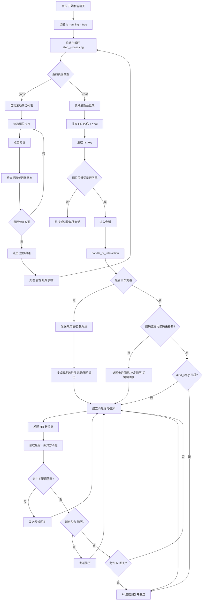

# BOSS「开始智能聊天」流程说明（面向 Python + Playwright 实现）

## 1. 文档目的

本文档基于 `G:\CodeProject\Script\Boss\Boss_helper.js` 中“开始智能聊天”相关逻辑整理，目标是帮助将该能力融合进 Python 自动化脚本中，并使用 Playwright 完成页面交互。

重点包含：

- 业务流程
- 状态设计
- 页面元素与选择器
- 各分支处理逻辑
- 适合 Playwright 的落地建议

本文关注的是“点击开始智能聊天之后会发生什么”，不是整套海投 UI 的完整还原。

---

## 2. 总体结论

“开始智能聊天”不是“立即调用一次 AI 回复”这么简单，而是启动一个持续运行的自动处理循环。

点击后，脚本会：

1. 切换到运行中状态
2. 记录开始日志
3. 启动主循环 `startProcessing()`
4. 根据当前页面决定走：
   - 职位列表页流程 `/jobs`
   - 聊天页流程 `/chat`
5. 在聊天页中：
   - 定位当前/最新会话
   - 进入会话
   - 判断是否首次沟通
   - 自动发开场白
   - 按需发送附件简历/图片简历
   - 建立“新消息监听”
   - 对 HR 新消息做关键词回复、补发简历或 AI 回复

因此，Python 版本最好实现成一个“状态机 + 持续轮询 + 事件监听/增量检查”的自动化任务，而不是一组孤立的点击步骤。

---

## 3. 入口逻辑

源码按钮文案为：

- `开始智能聊天`
- 点击后切换为 `停止智能聊天`

对应入口函数：

- `toggleChatProcess()`

逻辑：

1. `state.isRunning = !state.isRunning`
2. 如果开启：
   - 设置按钮文字为“停止智能聊天”
   - 写日志“开始智能聊天”
   - 调用 `Core.startProcessing()`
3. 如果停止：
   - 设置按钮文字为“开始智能聊天”
   - 停止消息监听器 `messageObserver`
   - 写日志“停止智能聊天”

对 Python 来说，可对应为：

- 一个总开关 `running: bool`
- 一个主循环协程/任务
- 一个聊天页观察器或消息轮询器

---

## 4. 建议的 Python 状态模型

建议在 Python 中维护如下状态：

```python
from dataclasses import dataclass, field
from typing import Optional, Set, List, Dict

@dataclass
class BotSettings:
    auto_reply: bool = False
    auto_send_resume: bool = False
    auto_send_image_resume: bool = False
    communication_mode: str = "new-only"   # "new-only" / "auto"
    communication_include_keywords: List[str] = field(default_factory=list)
    recruiter_activity_status: List[str] = field(default_factory=lambda: ["不限"])
    exclude_headhunters: bool = False
    keyword_replies: List[Dict[str, str]] = field(default_factory=list)
    ai_role: str = ""
    image_resumes: List[Dict] = field(default_factory=list)
    max_ai_replies_per_day: int = 10

@dataclass
class RuntimeState:
    is_running: bool = False
    current_index: int = 0
    current_monitored_hr: Optional[str] = None
    last_processed_message: Optional[str] = None
    processing_message: bool = False
    job_list_cache: List = field(default_factory=list)

    sent_greetings_hrs: Set[str] = field(default_factory=set)
    sent_resume_hrs: Set[str] = field(default_factory=set)
    sent_image_resume_hrs: Set[str] = field(default_factory=set)
    processed_hrs: Set[str] = field(default_factory=set)

    ai_reply_count: int = 0
    last_ai_date: str = ""
```

建议持久化的字段：

- `sent_greetings_hrs`
- `sent_resume_hrs`
- `sent_image_resume_hrs`
- `ai_reply_count`
- `last_ai_date`
- 用户配置项

原因：

- 防止重复发送开场白
- 防止重复发简历
- 控制 AI 每日回复上限
- 支持脚本重启后继续工作

---

## 5. 页面类型分流

主循环逻辑会根据 URL 路径决定流程：

- `"/jobs"` -> 职位列表流程
- `"/chat"` -> 聊天流程

### 推荐实现

```python
async def start_processing(page):
    if "/jobs" in page.url:
        await auto_scroll_job_list(page)

    while state.is_running:
        if "/jobs" in page.url:
            await process_job_list(page)
        elif "/chat" in page.url:
            await handle_chat_page(page)
        await page.wait_for_timeout(1000)
```

说明：

- 这意味着“智能聊天”功能本身允许从职位页启动
- 从职位页启动后，会自动推进到沟通/聊天上下文

---

## 6. 页面元素与选择器清单

以下是源码中直接使用到、对 Playwright 实现最重要的元素。

### 6.1 职位列表页 `/jobs`

| 用途 | 选择器 | 说明 |
| --- | --- | --- |
| 岗位卡片 | `li.job-card-box` | 职位列表项 |
| 岗位名称 | `.job-name` | 用于职位关键词匹配 |
| 工作地点 | `.job-address-desc` / `.company-location` / `.job-area` | 用于地点匹配 |
| 猎头标识 | `.job-tag-icon` | 读取 `alt` 判断是否“猎头” |
| 招聘者在线标签 | `.boss-online-tag` | 值为“在线”时优先使用 |
| 招聘者活跃时间 | `.boss-active-time` | 如“本周活跃”等 |
| 立即沟通按钮 | `a.op-btn-chat` | 按钮文案为“立即沟通”时点击 |
| 弹窗留在此页按钮 | `.default-btn.cancel-btn` | 需按文本“留在此页”筛选 |

### 6.2 聊天页 `/chat`

| 用途 | 选择器 | 说明 |
| --- | --- | --- |
| 最新聊天会话项 | `ul[role="group"] li[role="listitem"][class]:has(.friend-content-warp)` | 脚本用它定位当前处理对象 |
| 会话头像/点击区域 | `.figure` | 点击进入该会话 |
| HR 名称 | `.name-text` | 用于构造 `hrKey` |
| 公司名 | `.name-box span:nth-child(2)` | 与 HR 名称组合形成唯一键 |
| 左侧会话滚动容器 | `.user-list-content` | `auto` 模式下随机滚动 |
| 聊天消息容器 | `.chat-message .im-list` | 监听新消息和读取消息列表 |
| 对方消息项 | `li.message-item.item-friend` | 只处理 HR 发送的消息 |
| 文本消息内容 | `.text span` | 读取最后一条 HR 文本 |
| 卡片消息包裹 | `.message-card-wrap` | 判断最后一条是否卡片消息 |
| 卡片按钮 | `.card-btn` | 找文本“同意”自动点击 |
| 聊天输入框 | `#chat-input` | AI 或自定义回复输入 |
| 发送按钮 | `.btn-send` | 发送消息；找不到时可回车 |
| 常用语按钮 | `.btn-dict` | 打开自我介绍/常用语面板 |
| 常用语列表 | `ul[data-v-f115c50c=""]` | 该选择器较脆弱，建议增加兜底 |
| 发简历按钮 | `.toolbar-btn` | 按按钮文本“发简历”筛选 |
| 简历列表 | `ul.resume-list` | 选择附件简历 |
| 简历项 | `li.list-item` | 对应每份简历 |
| 简历名称 | `.resume-name` | 用于岗位关键词匹配简历 |
| 简历发送确认按钮 | `button.btn-v2.btn-sure-v2.btn-confirm` | 确认发送附件简历 |
| 单份简历确认弹窗 | `.panel-resume.sentence-popover` | 只有一份简历时出现 |
| 单份简历确认按钮 | `.btn-sure-v2` | 直接确认发送 |
| 图片上传控件 | `.toolbar-btn-content.icon.btn-sendimg input[type="file"]` | 上传图片简历 |
| 岗位名 | `.position-name` / `.job-name` / `[class*="position-content"] .left-content .position-name` | 当前聊天对应岗位名 |

### 6.3 设置相关元素

| 用途 | 选择器 | 说明 |
| --- | --- | --- |
| 沟通岗位包含输入 | `#communication-include input` | 用户输入岗位关键词 |
| 沟通模式选择框 | `#communication-mode-selector select` | `new-only` / `auto` |

说明：

- 原脚本某些选择器依赖页面当前 DOM 结构和框架生成属性，不一定稳定
- Python 实现时建议优先用：
  - 文本定位
  - 角色定位
  - 更稳健的父子结构定位
- 对脆弱选择器建议至少加一个兜底选择器方案

---

## 7. 主流程拆解

## 7.1 启动后主循环

流程：

1. 判断当前页面是否是职位页
2. 如果是职位页，先滚动加载岗位
3. 进入循环
4. 每轮根据页面类型执行处理函数
5. 每轮 sleep 1000ms

推荐 Python 落地：

- 用单独的 `asyncio.Task`
- 停止时设置 `state.is_running = False`
- 所有子步骤在开头都检查是否仍在运行

---

## 7.2 职位页流程 `process_job_list`

该流程是从职位页推进到沟通页的重要桥梁。

### 步骤

1. 读取所有 `li.job-card-box`
2. 对岗位做过滤：
   - 职位名称包含关键词
   - 工作地点包含关键词
   - 如启用，排除猎头
3. 若无匹配岗位：
   - 记录日志
   - 停止流程
4. 取当前索引对应岗位卡片
5. 滚动到可视区域并点击
6. 等待详情加载
7. 判断招聘者状态：
   - 在线
   - 活跃时间
8. 若不满足活动状态筛选则跳过
9. 查找 `a.op-btn-chat`
10. 若按钮文本为“立即沟通”则点击
11. 处理弹窗“留在此页”
12. 下一轮主循环通常就会进入聊天页逻辑

### Playwright 实现建议

```python
cards = page.locator("li.job-card-box")
count = await cards.count()
for i in range(count):
    card = cards.nth(i)
```

注意点：

- 岗位列表是懒加载的，必须先滚动
- 页面切换和右侧详情刷新后，旧 locator 可能失效
- 建议每次处理时重新查询 locator，而不是长期缓存 ElementHandle

---

## 7.3 聊天页流程 `handle_chat_page`

这是“智能聊天”的核心流程。

### 步骤

1. 获取“最新会话项”
2. 读取：
   - HR 名称
   - 公司名称
3. 生成 `hr_key = f"{name}-{company}".lower()`
4. 如果当前正在监控的 HR 就是这个，且观察器已建立，则直接返回
5. 更新 `current_monitored_hr`
6. 重置消息处理状态：
   - `last_processed_message = None`
   - `processing_message = False`
7. 如果已有旧观察器，先清理
8. 如果配置了“岗位关键词过滤”：
   - 点击该会话
   - 读取当前岗位名
   - 若岗位名不含任一关键词，则跳过
   - 若沟通模式为 `auto`，则滚动左侧用户列表
9. 如果该会话未被标记为已点击：
   - 点击进入会话
   - 执行 `handle_hr_interaction(hr_key)`
   - 若为 `auto` 模式，再滚动左侧会话列表
10. 为当前聊天窗口建立新消息监听

### 为什么要生成 `hr_key`

因为后续所有去重逻辑都依赖它，例如：

- 是否已经发过开场白
- 是否已经发过简历
- 是否已经发过图片简历

建议格式保持一致：

```python
hr_key = f"{name}-{company}".strip().lower()
```

---

## 8. HR 交互状态机

原逻辑本质上是一个 HR 会话状态机。

### 8.1 总入口 `handle_hr_interaction(hr_key)`

流程优先级：

1. 如果从未向该 HR 发过招呼：
   - 走首次沟通流程
2. 否则如果简历或图片简历尚未完成：
   - 且 HR 已回复过
   - 走补充互动流程
3. 否则：
   - 执行 AI 回复

可以抽象为：

```text
未打招呼 -> 先打招呼
已打招呼但资料未补齐 -> 看情况补简历/处理卡片/关键词回复
资料已补齐 -> AI 回复
```

---

## 8.2 首次沟通流程

### 步骤

1. 记录日志 `首次沟通`
2. 调用 `send_greetings()`
3. 如果发送成功：
   - 将 `hr_key` 写入 `sent_greetings_hrs`
4. 然后调用 `_handle_resume_sending(hr_key)`

### `send_greetings()` 逻辑

1. 找到 `.btn-dict`
2. 点击常用语按钮
3. 等待常用语列表出现
4. 遍历列表中的每一个 `li`
5. 逐条点击发送

### 注意

它不是只发一条开场白，而是会把常用语列表中的每一条都点一遍。

如果你在 Python 中不希望这么激进，建议做配置化：

- `send_all_greetings = True/False`
- 或只发送第一条

---

## 8.3 自动发送附件简历

### 触发条件

- `auto_send_resume == True`
- 当前 HR 还未发送过附件简历

### 步骤

1. 找到工具栏里的“发简历”按钮
2. 若按钮带 `unable` 类，代表当前不可发送
3. 读取岗位名
4. 点击“发简历”
5. 判断是否出现“单简历确认弹窗”
6. 如果只有一份简历：
   - 点击确认按钮
7. 否则读取 `ul.resume-list`
8. 尝试根据岗位名做简历匹配
9. 匹配不到就默认选第一份
10. 点击简历项
11. 点击发送确认按钮
12. 记录该 HR 已发送过附件简历

### 简历匹配规则

原脚本的匹配方式很特殊：

1. 读取岗位名
2. 把岗位名拆成连续两个字的关键词
3. 遍历所有简历名称
4. 只要某个两字片段出现在简历名称里，就判定为匹配

示例：

- 岗位名：`Python开发工程师`
- 生成关键词：`Py`, `yt`, ... 这里只是示意，中文情况下就是连续两个汉字片段

更准确地说，它是“对清洗后的字符串做滑窗 2 字匹配”。

### Python 建议

保留兼容逻辑，但建议升级为：

1. 先精确匹配
2. 再关键词包含匹配
3. 再做 2 字滑窗匹配
4. 最后 fallback 第一份简历

---

## 8.4 自动发送图片简历

### 触发条件

- `auto_send_image_resume == True`
- 本地有图片简历配置
- 当前 HR 还未发送过图片简历

### 步骤

1. 读取岗位名
2. 从图片简历列表中选择最匹配的一份
3. 找到图片上传 input：
   - `.toolbar-btn-content.icon.btn-sendimg input[type="file"]`
4. 通过文件上传发送图片
5. 记录该 HR 已发送过图片简历

### 与原 JS 的差异

原脚本通过 Base64 还原 Blob/File 后手动赋值到 input。

Python + Playwright 中可直接：

```python
await page.set_input_files(selector, file_path)
```

如果图片在内存里，也可以写临时文件再上传。

---

## 8.5 后续互动流程 `_handle_follow_up_response`

### 处理优先级

1. 先判断最后一条是否是卡片消息
2. 如果是卡片消息：
   - 找按钮文本“同意”
   - 自动点击
   - 成功则结束本轮
3. 否则读取最后一条文本消息
4. 如果文本中包含“简历”或“发送简历”：
   - 优先尝试发图片简历
   - 再尝试发附件简历
5. 最后处理关键词回复

### 说明

这意味着后续互动不是直接走 AI，而是先把“交换资料”“确认卡片”“按关键词模板回复”这些更确定性的动作做完。

---

## 9. 新消息监听逻辑

原脚本在聊天容器上挂 `MutationObserver`，只要新增节点中出现 `.item-friend`，就认为 HR 发了新消息。

### 浏览器原生逻辑

监听节点：

- `.chat-message .im-list`

监听条件：

- `childList: true`
- `subtree: true`

触发条件：

- 新增节点包含 `.item-friend`

### Python + Playwright 落地建议

Playwright Python 没有直接复用页面内 `MutationObserver` 状态的必要，建议两种方案：

#### 方案 A：轮询最后一条消息

每隔 1 秒：

1. 获取最后一条 `li.message-item.item-friend`
2. 提取文本内容
3. 与 `last_processed_message` 比较
4. 若不同则执行处理

优点：

- 简单稳
- 可控

缺点：

- 实时性稍差

#### 方案 B：页面内注入监听器

通过 `page.evaluate()` 注入 `MutationObserver`，把新增消息写到 `window.__boss_last_message_event`，Python 侧轮询这个共享变量。

优点：

- 更接近原脚本

缺点：

- 状态同步更复杂

推荐先做方案 A。

---

## 10. 新消息处理流程 `handle_new_message`

当发现 HR 发来新消息时：

1. 若脚本已停止，直接返回
2. 若当前正在处理另一条消息，返回
3. 标记 `processing_message = True`
4. 读取最后一条 HR 消息
5. 清洗文本
6. 如果与 `last_processed_message` 相同，直接跳过
7. 更新 `last_processed_message`
8. 短暂等待后再次读取最后消息
9. 如果发现最后消息已变化，递归/重入重新处理最新消息
10. 进入业务分支：
   - 先关键词回复
   - 再检查“简历”关键词
   - 最后才可能进入自动回复
11. 完成后 `processing_message = False`

### 文本清洗规则

原逻辑会：

- 去掉 HTML 标签
- 去掉首尾空白
- 合并多空白为单空格
- 去掉零宽字符

建议 Python 也保留该逻辑，以减少误判。

---

## 11. 关键词回复逻辑

### 触发条件

- 存在 `keyword_replies`
- 最后一条 HR 消息包含某个关键词

### 行为

1. 遍历回复规则
2. 命中即发送预设回复
3. 成功则结束本轮后续处理

### 重要特点

关键词回复优先级高于：

- 自动发简历后的 AI 回复
- 常规 AI 自动回复

也就是说，只要命中关键词回复，通常就不会继续走 AI。

### Python 数据结构建议

```python
keyword_replies = [
    {"keyword": "期望薪资", "reply": "目前期望区间是..."},
    {"keyword": "到岗时间", "reply": "最快可在...到岗"},
]
```

---

## 12. AI 回复逻辑

### 触发条件

只有在以下情况下才更可能进入 AI 回复：

1. 已经完成首次沟通
2. 简历/图片简历流程已处理到位
3. 没有命中更高优先级分支
4. `auto_reply == True`

### 流程

1. 再次确认 `auto_reply` 开关
2. 获取最后一条 HR 消息
3. 检查当天日期
4. 如果进入新的一天：
   - 重置 `ai_reply_count = 0`
5. 若当天已达到上限 `10`：
   - 不再回复
6. 调用 AI 接口生成回复
7. 将文本写入 `#chat-input`
8. 点击 `.btn-send`
9. 若没有发送按钮则模拟回车
10. `ai_reply_count += 1`

### Python 设计建议

把 AI 层抽象成独立接口：

```python
async def generate_ai_reply(last_message: str, role_prompt: str) -> str:
    ...
```

不要把 AI 请求直接耦合在页面控制器里，这样后续更好替换模型。

### 建议额外增加

- 失败重试次数
- 回复最短/最长长度限制
- 敏感词校验
- 发送前日志记录

---

## 13. `communication_mode` 的设计含义

原脚本有两个模式：

- `new-only`
- `auto`

### `new-only`

含义：

- 只处理当前识别到的会话
- 不主动随机滚动左侧用户列表

适合：

- 手动点进某个聊天页后，让脚本辅助处理

### `auto`

含义：

- 在处理完一个聊天后，会随机滚动左侧会话列表
- 试图遍历更多候选会话

适合：

- 全自动轮询多个会话

### Python 落地建议

在 `auto` 模式下，左侧会话滚动可以简化为：

1. 获取 `.user-list-content`
2. 随机滚动若干次
3. 最后滚到顶部或底部

但更推荐更可控的方式：

- 明确遍历会话项列表
- 按索引切换会话
- 不用随机滚动

这样在 Playwright 中稳定性更高。

---

## 14. Playwright 实现建议

## 14.1 不建议照搬的点

原 JS 中这些做法在 Playwright 中不必照搬：

- `simulateClick()` 的鼠标事件序列
- 原生 `MutationObserver` 驱动的全部控制流
- 对 DOM 节点的长期缓存
- 通过 `document.execCommand("insertText")` 输入文本

### Playwright 替代方案

- 点击：`locator.click()`
- 输入：`locator.fill()` 或 `locator.press_sequentially()`
- 文件上传：`set_input_files()`
- 等待：`locator.wait_for()` 或显式轮询
- 事件监听：轮询最后一条消息

---

## 14.2 推荐模块划分

建议拆成以下模块：

1. `page_detector.py`
   - 判断 `/jobs` 或 `/chat`

2. `selectors.py`
   - 管理所有 CSS / text selector

3. `chat_service.py`
   - 读取当前会话信息
   - 读取最后消息
   - 发送文本
   - 监听/轮询新消息

4. `resume_service.py`
   - 附件简历发送
   - 图片简历发送
   - 简历匹配

5. `hr_state_service.py`
   - 管理 `hr_key`
   - 去重集合
   - 持久化

6. `ai_service.py`
   - 生成 AI 回复

7. `boss_bot.py`
   - 总状态机与主循环

---

## 14.3 推荐伪代码

```python
async def run_bot(page, settings, state):
    state.is_running = True

    if "/jobs" in page.url:
        await auto_scroll_job_list(page)

    while state.is_running:
        if "/jobs" in page.url:
            await process_job_list(page, settings, state)
        elif "/chat" in page.url:
            await handle_chat_page(page, settings, state)

        await page.wait_for_timeout(1000)


async def handle_chat_page(page, settings, state):
    latest_chat = await get_latest_chat_item(page)
    if not latest_chat:
        return

    name = await latest_chat.locator(".name-text").inner_text()
    company = await latest_chat.locator(".name-box span:nth-child(2)").inner_text()
    hr_key = f"{name}-{company}".strip().lower()

    if state.current_monitored_hr == hr_key:
        await poll_new_message(page, hr_key, settings, state)
        return

    state.current_monitored_hr = hr_key
    state.last_processed_message = None
    state.processing_message = False

    await open_chat_if_needed(latest_chat)

    if settings.communication_include_keywords:
        position_name = await get_position_name(page)
        if not match_keywords(position_name, settings.communication_include_keywords):
            return

    await handle_hr_interaction(page, hr_key, settings, state)
    await poll_new_message(page, hr_key, settings, state)


async def handle_hr_interaction(page, hr_key, settings, state):
    if hr_key not in state.sent_greetings_hrs:
        ok = await send_greetings(page)
        if ok:
            state.sent_greetings_hrs.add(hr_key)
            await handle_resume_sending(page, hr_key, settings, state)
        return

    missing_resume = hr_key not in state.sent_resume_hrs
    missing_image = hr_key not in state.sent_image_resume_hrs

    if missing_resume or missing_image:
        if await has_hr_responded(page):
            await handle_follow_up_response(page, hr_key, settings, state)
        return

    if settings.auto_reply:
        await ai_reply(page, settings, state)
```

---

## 15. 易错点与融合建议

## 15.1 选择器容易漂移

尤其是这些：

- `ul[data-v-f115c50c=""]`
- 某些 class 可能是站点版本相关

建议：

- 统一封装 selector
- 为关键元素提供主备选择器
- 必须做失败兜底日志

## 15.2 左侧“最新会话”的定义不一定稳定

源码直接取：

- `ul[role="group"] li[role="listitem"][class]:has(.friend-content-warp)`

这更像“当前列表中的某个会话项”，不一定严格等于“最新未读会话”。

Python 实现建议根据你的目标重新定义：

- 当前选中会话
- 第一条未读会话
- 最近活跃会话

这三种策略需要明确。

## 15.3 原脚本对“是否已点击某会话”的记忆是 DOM class

原逻辑通过给节点加 `last-clicked` 避免重复点击。

Playwright 版本不建议依赖 DOM 注入标记，建议改成 Python 侧状态：

- `last_opened_hr_key`

## 15.4 AI 回复要控制节奏

建议新增：

- 发送前 1 到 3 秒随机延时
- 回复最小间隔
- 单 HR 连续回复节流

这样更接近人工行为。

## 15.5 发简历权限判断很关键

原脚本会检查按钮是否含 `unable` 类。

Playwright 必须保留这个判断，否则会在未授权发送时误触发流程异常。

---

## 16. 建议交给实现型 AI 的任务描述

如果你要把这份文档发给另一个 AI 来产出 Python + Playwright 代码，可以直接附上下面这段需求描述：

```text
请基于这份 Markdown 说明，实现一个 Python + Playwright 的 BOSS 直聘聊天自动化模块，要求：

1. 使用异步 Playwright
2. 采用状态机设计，不要写成一串硬编码脚本
3. 支持页面分流：/jobs 与 /chat
4. 支持首次沟通、自动发送简历、自动发送图片简历、关键词回复、AI 自动回复
5. 支持 hr_key 去重
6. 支持每日 AI 回复次数限制
7. 所有关键选择器统一收口管理
8. 所有关键动作要有超时、异常处理和日志
9. 不要照搬 JS 的 MutationObserver，实现成更稳定的 Playwright 轮询逻辑
10. 代码结构建议拆成 selectors / state / chat_service / resume_service / ai_service / bot_controller
```

---

## 17. 流程图



---

## 18. 源码定位

本说明整理自以下源码文件：

- `G:\CodeProject\Script\Boss\Boss_helper.js`

主要相关逻辑区段：

- 智能聊天按钮创建
- `toggleChatProcess()`
- `Core.startProcessing()`
- `Core.handleChatPage()`
- `Core.handleNewMessage()`
- `HRInteractionManager.handleHRInteraction()`
- `HRInteractionManager.sendGreetings()`
- `HRInteractionManager.sendResume()`
- `HRInteractionManager.sendImageResume()`
- `Core.aiReply()`

